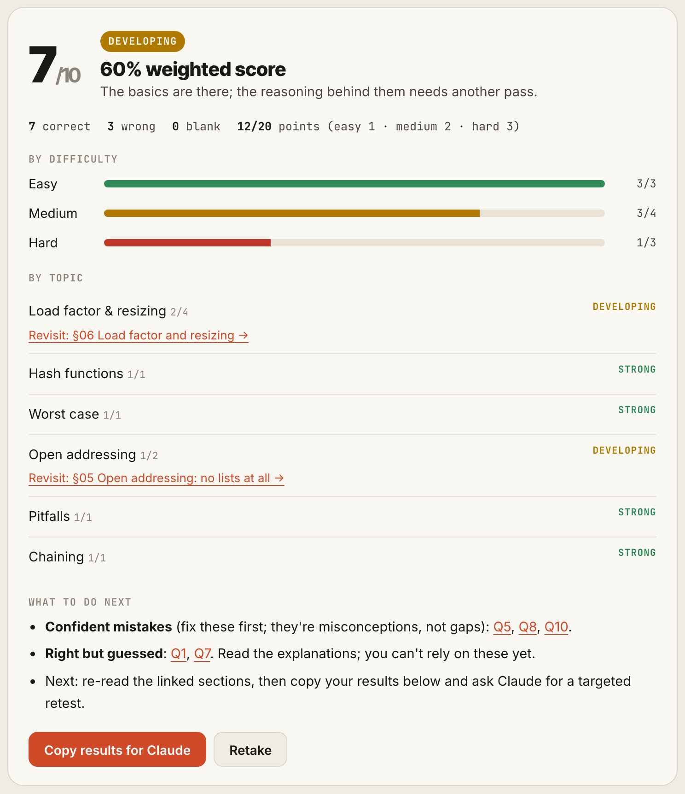
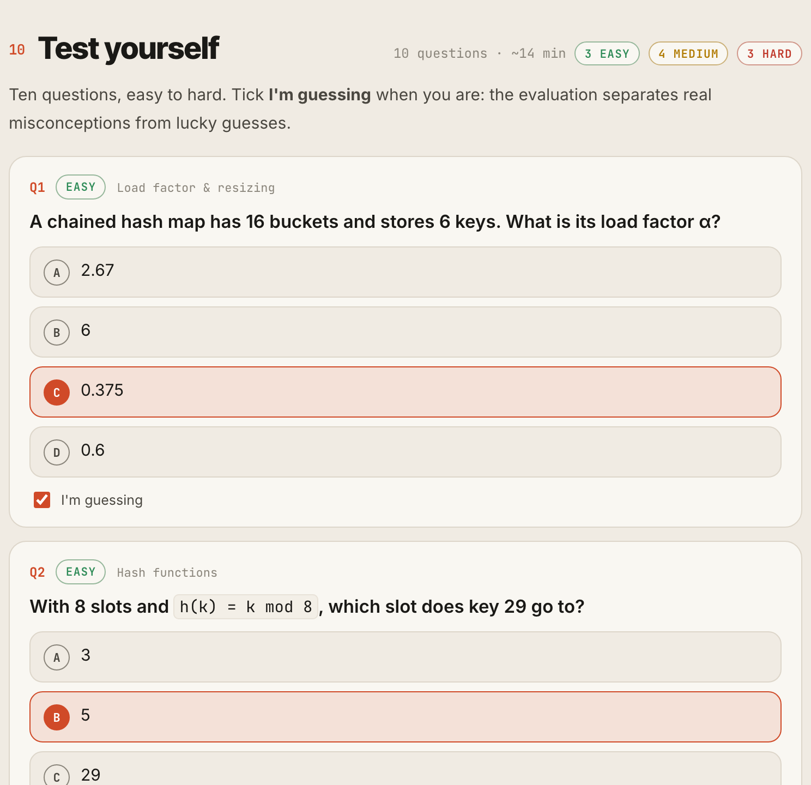

<h1 align="center">Course Lab</h1>

<p align="center">
  An agent skill that writes courses that test the learner: every chapter ends with a 10-question quiz,<br>
  the page grades it instantly, and Claude turns the results into a diagnosis and a targeted retest.<br>
  Built on <a href="https://github.com/akshaypjoshi/course-studio">Course Studio</a>.
</p>

<p align="center">
  <a href="https://github.com/akshaypjoshi/course-lab/actions/workflows/ci.yml"></a>
  <a href="LICENSE"></a>
  <a href="#install"></a>
  <a href="#install"></a>
  <a href="https://skills.akshayjoshi.dev/course-lab/"></a>
</p>

<p align="center">
  <picture>
    <source media="(prefers-color-scheme: dark)" srcset=".github/assets/result-dark.png">
    
  </picture>
</p>

Ask for *"the hashing chapter with a quiz"* or *"a short course on rate limiting, with tests"* and you get a Course Studio chapter (dense, verified, with its interactive figure) that ends in a **Test yourself** section: 10 questions, 3 easy, 4 medium and 3 hard, each wrong option a specific mistake with a reason. The learner answers in the page, ticks **I'm guessing** when they are, and gets an instant grade with a level, a breakdown by difficulty and by topic, and links back to the sections to re-read.

Then they press **Copy results for Claude** and paste the report into the chat. Claude reads the options they picked, separates misconceptions (wrong and sure) from gaps, shaky knowledge and slips, replies with what to fix first and how to practise, and builds a new 10-question retest weighted to the weak topics.

**Website and live demo:** [skills.akshayjoshi.dev/course-lab](https://skills.akshayjoshi.dev/course-lab/) has the Hashing quiz running live, and the [full chapter](https://skills.akshayjoshi.dev/course-lab/example/dsa/05-hashing.html#quiz) with its quiz at the end.

## What it does

| You ask for | You get |
|---|---|
| a course on X, with tests | a Course Studio course plan, its chapters, a quiz at the end of each, and a final test once two chapters are written |
| a chapter on X | the chapter (text, run code, Anatomy figure, built page) + its quiz |
| a quiz for chapter N | `quiz.json` for the existing chapter, added to its page |
| a final test | `final-quiz.json` across the written chapters, at the end of the course page, grouped by chapter |
| *(pasted results)* | a short diagnosis: misconceptions first, sections to re-read, concrete practice, and a retest page |

<p align="center">
  <picture>
    <source media="(prefers-color-scheme: dark)" srcset=".github/assets/quiz-dark.png">
    
  </picture>
</p>

### What the learner sees

- **The quiz in the chapter page**, as its last numbered section and in the table of contents. Questions run easy to hard; code questions show the code.
- **An instant grade.** Easy, medium and hard are worth 1, 2 and 3 points, so the level reflects depth: **Mastered** (85% weighted and at least 2 of 3 hard right), **Proficient** (65%), **Developing** (40%) or **Needs review**.
- **A breakdown** by difficulty and by topic, a **Revisit** link to the exact section for every weak topic, and *what to do next*: confident mistakes to fix first, right answers that were only guesses, slips on easy questions.
- **Every answer explained**, with the reason the picked wrong option was tempting.
- **Copy results for Claude**: a stable, line-based report (`Q6 [medium · Pitfalls] picked A: wrong, answer B (was sure)`) to paste back for an evaluation. The page keeps the last 10 attempts in the browser.

Light, dark and phone layouts all use Course Studio's tokens, so the quiz matches the chapter.

### What makes the quizzes trustworthy

- **They test the finished chapter**, not the outline: every question is answerable from its text, code or figure, and maps to one of its outcomes.
- **The mix is real.** Easy is one step, medium is two ideas or a small new case, hard is transfer (a trace, a "what breaks if", a trade-off with numbers), not longer wording.
- **Every distractor is a named mistake** (a formula upside down, the average case where the worst was asked, what the *correct* code would do) with a rationale, so the evaluation can say *what* the learner believes.
- **Every answer is verified** by computing it, running the snippet, or tracing the chapter's own code, and each distractor's number is the one its mistake really gives.
- **`lab.py validate`** checks structure, the 3/4/3 mix, answer-position skew, topic spread and that every `section` resolves to a real heading.
- **`check_lab.py` takes every quiz** in a headless browser on desktop, then phone + dark: all right (must be Mastered), all wrong (Needs review), and a mixed attempt with a guess and a blank, checking the score, insights, revisit links, the copy-for-Claude report and retake.

## Install

Course Lab writes only the quizzes and uses **Course Studio** for everything else (planning, writing, figures, page builds), so install both.

### With the skills CLI (`npx`)

```bash
npx skills add akshaypjoshi/course-studio -g -a claude-code
npx skills add akshaypjoshi/course-lab -g -a claude-code
```

Drop `-g` to install into the current project instead of globally, or swap `-a claude-code` for another agent the [skills CLI](https://github.com/vercel-labs/skills) supports.

### As a Claude Code plugin (`/plugin`)

Inside Claude Code:

```
/plugin marketplace add akshaypjoshi/course-lab
/plugin install course-studio@course-lab
/plugin install course-lab@course-lab
```

The `course-lab` marketplace lists both plugins; `course-studio` comes from its own repository.

### Requirements

| | Needed for |
|---|---|
| Python 3.9+ with `markdown`, `pyyaml`, `pygments` | building pages |
| `playwright` + Chromium | `check_lab.py` (takes the quizzes headless) |
| Node.js 20.10+ | Course Studio's figures |

```bash
# installed with npx -g:
pip install -r ~/.claude/skills/course-lab/requirements.txt
# installed as a plugin:
pip install -r ~/.claude/plugins/marketplaces/course-lab/skills/course-lab/requirements.txt

python3 -m playwright install chromium
```

`lab.py` finds Course Studio by itself (in the project's or your home `.claude/skills/`, in a Claude Code plugin install, or in `/mnt/skills` on claude.ai). If it lives somewhere else, set `COURSE_STUDIO=<path to the course-studio skill folder>`.

## Use it

Just ask, in any project:

```
Write the binary search chapter of the DSA course, with a quiz.
Make a short course on rate limiting, 4 chapters, with tests.
Add a quiz to chapter 5.
Write the final test for the System Design course.
course-lab results
Quiz: Hashing, chapter test [dsa-05-hashing] · Data Structures & Algorithms
Score: 4/10 · weighted 6/20 (30%) · level: Needs review
...
```

Work lands next to the course it belongs to:

```
courses/dsa/
  course.json
  final-quiz.json                     final test (once two chapters are written)
  chapters/05-hashing/
    chapter.md                        written by Course Studio
    figures/...
    quiz.json                         the chapter's quiz
  retests/dsa-05-hashing-retest-1.json
  dist/
    index.html                        course page (+ final test)
    05-hashing.html                   chapter page, quiz at the end
    dsa-05-hashing-retest-1.html      a retest page
```

Pages stay self-contained HTML. The quiz payload is base64 JSON in the page, which keeps answers out of sight for self-study; for real exams, keep `quiz.json` on a server and grade there with the same rules.

### The quiz format

```json
{
  "title": "Hashing, chapter test",
  "questions": [
    {
      "difficulty": "hard",
      "topic": "Open addressing",
      "section": "Open addressing",
      "question": "Linear probing, m = 8 ... What does `get(19)` do?",
      "options": ["...", "...", "...", "..."],
      "answer": 3,
      "explanation": "1-3 sentences with the working.",
      "rationales": ["why A is tempting and wrong", "...", "...", null]
    }
  ]
}
```

The full format is in [`references/quiz-format.md`](skills/course-lab/references/quiz-format.md), and a finished quiz for Course Studio's example Hashing chapter is in [`examples/`](skills/course-lab/examples/courses/dsa/chapters/05-hashing/quiz.json).

## The scripts

All in `skills/course-lab/scripts/`; the skill runs them for you.

| Script | Does |
|---|---|
| `lab.py build <course-dir> [--catalog]` | Course Studio build, then every chapter quiz and the final test added to their pages |
| `lab.py validate <quiz.json> [--course-dir <dir>]` | structure, 3/4/3 mix, answer skew, topics, sections; prints `ok` when clean |
| `lab.py quiz <retest.json> <course-dir>` | a standalone quiz page in `dist/` (retests) |
| `check_lab.py <dist \| page.html> [--mobile] [--dark] [--all]` | Course Studio's page check + takes every quiz headless; exits 1 on any problem |

After adding quizzes, always rebuild with `lab.py build`: Course Studio's `build_course.py` on its own rebuilds the pages without them.

## How the skill works

| File | Covers |
|---|---|
| [`SKILL.md`](skills/course-lab/SKILL.md) | scope table, the chapter + quiz workflow, evaluation, quality bar |
| [`references/questions.md`](skills/course-lab/references/questions.md) | what to test, the 3/4/3 mix, distractors and rationales, patterns per subject, final tests, retests, verification |
| [`references/quiz-format.md`](skills/course-lab/references/quiz-format.md) | the JSON format for chapter quizzes, final tests and retests, and the commands |
| [`references/evaluation.md`](skills/course-lab/references/evaluation.md) | reading pasted results, misconception / gap / shaky / slip, the reply, the retest loop, progress over attempts |

For a standalone timed test that doesn't belong to a course ("test me on SQL joins"), see [mcq-test](https://github.com/akshaypjoshi/mcq-test-skill).

## Development

```bash
pip install -r skills/course-lab/requirements.txt && python3 -m playwright install chromium
tests/smoke.sh        # needs Node.js 20.10+ and git
```

The smoke test clones Course Studio (or uses `COURSE_STUDIO=<path>`), builds its example DSA course with this repo's Hashing quiz, checks that a rebuild doesn't add the quiz twice, builds a retest page, takes every quiz headless on desktop and phone + dark, and confirms that `validate` catches a broken quiz. CI runs it on every push, validates the plugin manifests and `SKILL.md` frontmatter, and fails on any em dash in the repository.

```
.claude-plugin/            plugin.json + marketplace.json (lists course-lab and course-studio)
skills/course-lab/         the skill itself (what npx skills add installs)
  SKILL.md                 entry point
  references/              questions, quiz format, evaluation
  scripts/                 lab.py, check_lab.py
  assets/                  quiz.js + quiz.css (the in-page quiz and grader)
  examples/                the Hashing chapter quiz
evals/                     trigger evals and task evals (skill-creator format)
site/                      the website: landing page + build.py (builds the live demo)
tests/smoke.sh             end-to-end smoke test
tools/check_no_em_dash.py  house-style check
```

The website is published from the [akshaypjoshi/skills](https://github.com/akshaypjoshi/skills) hub, which runs `site/build.py` and deploys to GitHub Pages. Preview it locally with `python3 site/build.py /tmp/site && python3 -m http.server -d /tmp/site`.

See [CONTRIBUTING.md](CONTRIBUTING.md) for the rest, and [CHANGELOG.md](CHANGELOG.md) for what changed in each version.

## License

[MIT](LICENSE)
